**Analyzing Gourmet House Sales: Insights for Performance & Strategy | SQL**

Author: Ho Nguyen Nhu Quynh

Tool used: SQL (SQL Server)

**Table of Contents**

- Background & Overview
- Dataset Description & Data Structure
- Main Process
- Final Conclusion & Recommendation

**Background & Overview**

**What is this about? What Business Question will it solve?**
 The project use SQL Server to analyze the performance of Gourmet House - a fast food chain restaurant and identify key insights to help improve sales performance and optimize business strategies

**How is the business doing overall?**** Headline sales, profit, average price and units, plus trends by year, quarter, month and day (growth, seasonality, slow periods)

**Who and when earns the profit?**** Top and bottom stores. Underperformers are where improvement is possible

**Which product categories segments drive sales, units and profit?**

**Which sales method (in-store, online, outlet) generates the most sales and profit?**


**Who is this project for?**
- Sales team
- Marketing team

**Dataset Description & Data Structure**

- Data Source: The data provided for study and research purpose
- Data size: 17,000

**Main process:**

**1. Clean data:**

#### 1.1 Understand the dataset (Data Exploration)

```sql
SELECT 'menu' AS tb1, COUNT (*) AS n FROM menu
UNION ALL SELECT 'sales', COUNT(*) FROM sales
UNION ALL SELECT 'stores', COUNT(*) FROM stores
UNION ALL SELECT 'Customer', COUNT(*) FROM customers;

SELECT TABLE_NAME, COLUMN_NAME,DATA_TYPE
FROM INFORMATION_SCHEMA.COLUMNS
WHERE TABLE_NAME in ('menu','customers','sales','stores')
ORDER BY TABLE_NAME, ORDINAL_POSITION;
```

The result:

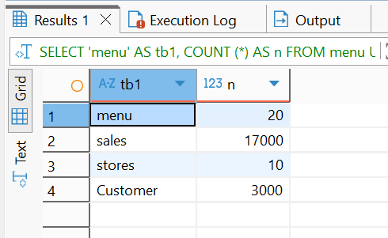

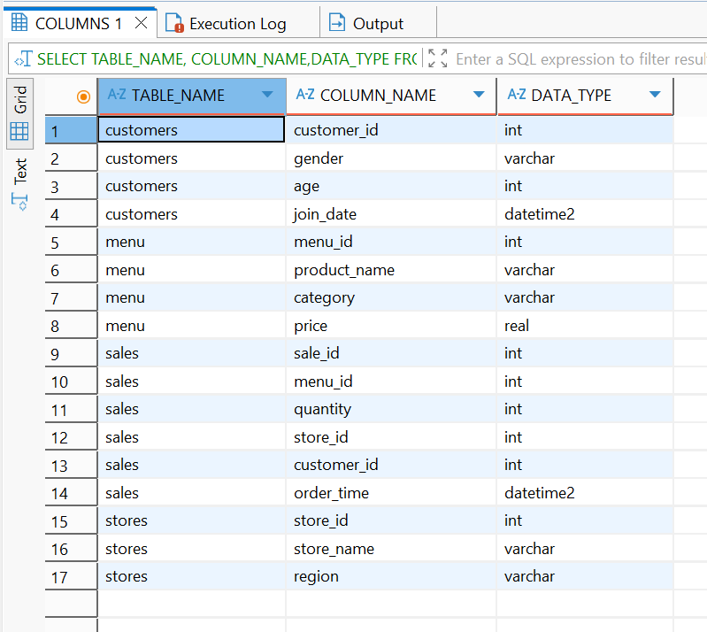

Well noted on the number of rows in each table and data type in each table. 

Ordertime and join_date is now nvarchar type. Thus need to change back to date type to support further analyst

```sql
ALTER TABLE sales ADD order_time_dt datetime2(0);
UPDATE sales SET order_time_dt = TRY_CONVERT(datetime2, order_time,120);
ALTER TABLE sales DROP COLUMN order_time;
EXEC sp_rename 'sales.order_time_dt','order_time', 'COLUMN';

ALTER TABLE customers ADD join_date_dt datetime2(0);
UPDATE customers SET join_date_dt = TRY_CONVERT(datetime2, join_date,120);
ALTER TABLE customers DROP COLUMN join_date;
EXEC sp_rename 'customers.join_date_dt','join_date', 'COLUMN';

SELECT * FROM customers;
```

#### 1.2 Check for missing value (Nulls)

```sql
SELECT
	SUM(CASE WHEN customer_id IS NULL THEN 1 ELSE 0 END) AS null_customer_id,
	SUM(CASE WHEN join_date IS NULL THEN 1 ELSE 0 END) AS null_join_date,
	SUM(CASE WHEN gender IS NULL THEN 1 ELSE 0 END) AS null_gender,
	SUM(CASE WHEN age IS NULL THEN 1 ELSE 0 END) AS null_age
FROM customers;	
-- There is no NUll in customer table

SELECT
	SUM(CASE WHEN menu_id IS NULL THEN 1 ELSE 0 END) AS null_menu_id,
	SUM(CASE WHEN product_name IS NULL THEN 1 ELSE 0 END) AS null_product_name,
	SUM(CASE WHEN category IS NULL THEN 1 ELSE 0 END) AS null_category,
	SUM(CASE WHEN price IS NULL THEN 1 ELSE 0 END) AS null_price
FROM menu;	
-- There is no null in menu table

SELECT
	SUM(CASE WHEN sale_id IS NULL THEN 1 ELSE 0 END) AS null_sale_id,
	SUM(CASE WHEN order_time IS NULL THEN 1 ELSE 0 END) AS null_order_time,
	SUM(CASE WHEN menu_id IS NULL THEN 1 ELSE 0 END) AS null_menu_id,
	SUM(CASE WHEN quantity IS NULL THEN 1 ELSE 0 END) AS null_quantiy,
	SUM(CASE WHEN store_id IS NULL THEN 1 ELSE 0 END) AS null_store_id,
	SUM(CASE WHEN customer_id IS NULL THEN 1 ELSE 0 END) AS null_customer_id
FROM sales;
-- There is no null in sales table

SELECT
	SUM(CASE WHEN store_id IS NULL THEN 1 ELSE 0 END) AS null_store_id,
	SUM(CASE WHEN store_name IS NULL THEN 1 ELSE 0 END) AS null_store_name,
	SUM(CASE WHEN region IS NULL THEN 1 ELSE 0 END) AS null_region
FROM stores;
-- There is no null in stores table
```

#### 1.3 Check for duplicate

```sql
--find duplitacte in customer_id
SELECT customer_id, COUNT(*) AS cnt
FROM customers
GROUP BY customer_id
HAVING COUNT(*)>1;

--find duplicate in menu_id
SELECT menu_id, COUNT(*) AS cnt
FROM menu
GROUP BY menu_id
HAVING COUNT(*)>1;

--find duplicate in sales table
SELECT order_time, menu_id, quantity, store_id, customer_id, COUNT(*) AS cnt
FROM sales
GROUP BY order_time, menu_id, quantity, store_id, customer_id
HAVING COUNT(*)>1;
```

#### 1.4 Check orphan key (Sale that point to missing record)

```sql
SELECT COUNT(*) AS orphan_menu
FROM sales s 
LEFT JOIN menu m 
ON s.menu_id = m.menu_id
WHERE m.menu_id IS NULL;

SELECT COUNT(*) AS orphan_store
FROM sales s 
LEFT JOIN stores s2 
ON s.store_id = s2.store_id 
WHERE s2.store_id IS NULL;

SELECT COUNT(*) AS orphan_customer
FROM sales s 
LEFT JOIN customers c
ON s.customer_id = c.customer_id 
WHERE c.customer_id IS NULL;

```

#### 1.5 Check inconsistent format and value

```sql
SELECT category, COUNT(*) FROM menu GROUP BY category;
SELECT gender, COUNT(*) FROM customers GROUP BY gender;
SELECT region, COUNT(*) FROM stores GROUP BY region;
SELECT * FROM menu WHERE product_name <> LTRIM(RTRIM(product_name));
SELECT * FROM stores WHERE store_name <> LTRIM(RTRIM(store_name));
```

```sql
SELECT store_id, store_name, region FROM stores;
UPDATE stores SET store_name = N'Gourmet Binh Thanh' WHERE store_id=3;
UPDATE stores SET store_name = N'Gourmet Phu Nhuan' WHERE store_id=4;
UPDATE stores SET store_name = N'Gourmet Go Vap' WHERE store_id=5;
UPDATE stores SET store_name = N'Gourmet Thu Duc' WHERE store_id=6;
UPDATE stores SET store_name = N'Gourmet Tan Binh' WHERE store_id=7;
```

### 2. Main process

#### 2.1 Sales Performance

#### 2.1.1 Total revenue, total orders, average order value

```sql
SELECT ROUND(SUM(quantity*price),2) AS total_revenue, 
		COUNT(*) AS total_ordered,
		ROUND(SUM(quantity*price)/COUNT(*),2) AS avg_order_value,
		ROUND(SUM(quantity)/COUNT(*),2) AS avg_item_per_order
FROM sales s
JOIN menu m
ON s.menu_id = m.menu_id;
```

Result:

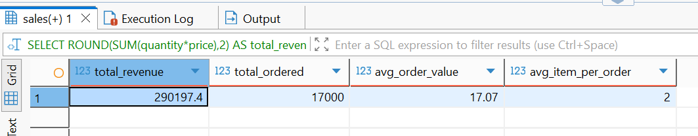


**Insight**: Gourmet House earned 290.197 from 17.000 orders, averaging 17,01 per order and 2 items per order.

**Recommendation**: The items per order is 2, the easiest growth lever is raising basket size with combos and add-ons, not only getting more orders.

#### 2.1.2 Top 5 best seller (base on quantity)

```sql
SELECT TOP 5 m.product_name AS product_name, 
		SUM(quantity) AS total_order_quantity,
		CAST(100.0 * SUM(s.quantity) / SUM(SUM(s.quantity)) OVER () AS decimal(5,2)) AS pct_of_units
FROM sales s
JOIN menu m
ON s.menu_id = m.menu_id
GROUP BY m.product_name
ORDER BY SUM(s.quantity) DESC;
```

Result


**Insight**: The top 5 products, Matcha Latte, Spicy Ramen, Tuna Sandwich, Lemon Soda, Tempura Set, account for 25% of all units sold, and they span all three categories (Drink, Main, Snack). Matcha Latte leads with 2216 units (5.21%).

**Recommendation**: Because best sellers cover every category, they are natural candidates for combo bundles (for example, Spicy Ramen + Matcha Latte ). 

#### 2.1.3 Top 3 product by revenue

```sql
WITH product_stats AS (
SELECT m.product_name AS product_name, 
				SUM(quantity) AS unit_sold,
				ROUND(SUM(s.quantity * m.price),2) AS total_revenue
FROM sales s
JOIN menu m
ON s.menu_id = m.menu_id
GROUP BY m.product_name)
SELECT product_name, total_revenue, unit_sold,
		CAST(total_revenue/SUM(total_revenue) OVER () AS decimal(5,2)) AS pct_of_revenue
FROM product_stats
ORDER BY total_revenue DESC;
```

Result

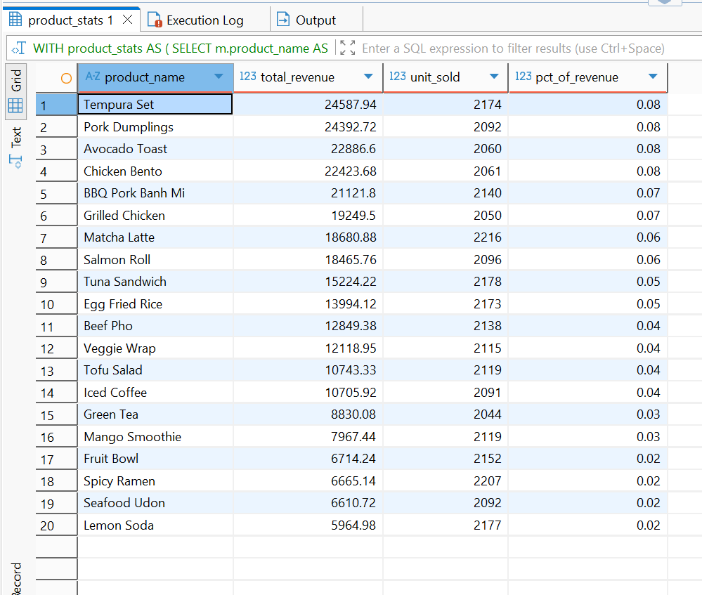

**Insight**: The top 3 products by revenue are Tempura Set, Pork Dumplings and Avocado Toast, together generating 24% of total revenue. Only Tempura Set also appears in the top 5 by units, **so volume and revenue don’t always go together:** Matcha Latte ranks 1st place by units but earns 24% less than Tempura Set despite 2,216 units

**Recommendation**: Protect and promote the high-revenue items (Tempura Set, Port Dumplings and Avocado Toast). For high-volume, low-price items such as Matcha Latte, use them as traffic drivers and pair them with a higher-priced item in a combo, instead of discounting them.

#### 2.1.4 Revenue share by category

```sql
WITH revenue_by_category AS (
	SELECT m.category, 
					COUNT(DISTINCT m.menu_id) AS products,
					SUM(s.quantity) AS units_sold
					ROUND(SUM(s.quantity*m.price),2) AS total_revenue
	FROM sales s
	JOIN menu m
	ON s.menu_id = m.menu_id
	GROUP BY m.category)
SELECT category, products, units_sold,
		CAST (100.0 * total_revenue/SUM(total_revenue) OVER () AS decimal(5,2)) AS pct_per_rev,
		CAST(100.0 * units_sold/ SUM(units_sold) OVER () AS decimal(5,2)) AS pct_units,
		ROUND(1.0* total_revenue/ products,2) AS revenue_per_products
FROM revenue_by_category;
```

Result:

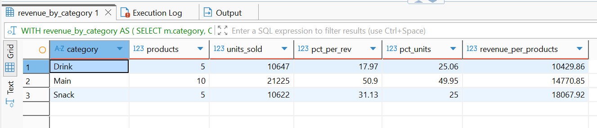

**Insight**: Main dishes generate 50.9% of revenue followed by Snack 31.13% and Drink 17.97%.

Main earns of revenue from 21.225 units, so each Main item sold is worth more than a Snack or Drinks. Drinks has the lowest revenue per product

**Recommendation**: Keep main as revenue anchor. Use Drink and Snack as add-ons to lift order value, for example a discounted Drink or Snack with every Main, instead of competing on price

#### 2.1.5 Best Product by category

```sql
WITH product_revenue AS(
	SELECT category, product_name, ROUND(SUM(quantity*price),2) AS total_revenue
	FROM sales s 
	JOIN menu m
	ON s.menu_id = m.menu_id
	GROUP BY m.category, m.product_name),
ranked AS (
	SELECT category, product_name, total_revenue,
			RANK () OVER(PARTITION BY category ORDER BY total_revenue DESC) AS rnk,
			CAST(100.0*total_revenue/SUM(total_revenue) OVER (PARTITION BY category) AS decimal(5,2)) AS pct_per_category,
			COUNT(*) OVER(PARTITION BY category) AS products_in_category
	FROM product_revenue)
SELECT category, product_name, total_revenue, pct_per_category, products_in_category,
		CAST(100.0/ products_in_category AS decimal(5,2)) AS even_split_pct
FROM ranked
WHERE rnk <= 2
ORDER BY total_revenue DESC, rnk;
```

Result

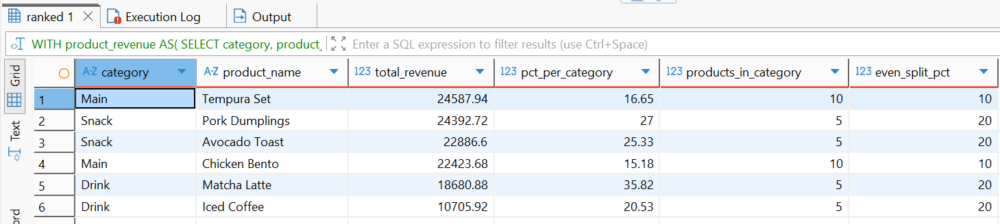

**Insight:** The best seller in each category is Matcha Latte (Drink, 35.82% of Drink revenue), Pork Dumplings (Snack, 27%) and Tempura Set (Main, 16.65%). Only Drink depends on one product: Matcha leads Iced Coffee by 15.3 points. Snack is a close race between Pork Dumplings and Avocado Toast (1.67 points apart, together 52.33% of Snack). Main is spread across 10 products, and Tempura Set earns about 1.7× an even share (16.65% vs 10%).

**Recommendation:** 

- Protect supply and quality of Matcha Latte, and promote Iced Coffee and the other Drinks to reduce dependence on one item.
- Bundle both Snack leaders with Main dishes.
- In Main, no single hero carries the category, so test promotions on the mid-ranked items to lift the whole category.

#### 2.1.7 Store revenue distribution and average order value per store

```sql
SELECT
    st.store_name,
    st.region,
    COUNT(*)                                          AS orders,
    SUM(s.quantity)                                   AS units_sold,
    ROUND(SUM(s.quantity * m.price), 2)               AS total_revenue,
    CAST(100.0 * SUM(s.quantity * m.price)
         / SUM(SUM(s.quantity * m.price)) OVER () AS decimal(5,2)) AS pct_of_revenue,
    ROUND(1.0 * SUM(s.quantity * m.price) / COUNT(*), 2)          AS avg_order_value,
    CAST(100.0 * (1.0 * SUM(s.quantity * m.price)
         / AVG(SUM(s.quantity * m.price)) OVER () - 1) AS decimal(6,2)) AS vs_avg_store_pct
FROM sales s
JOIN menu m    ON s.menu_id = m.menu_id
JOIN stores st ON s.store_id = st.store_id
GROUP BY st.store_id, st.store_name, st.region
ORDER BY total_revenue DESC;
```

Result:

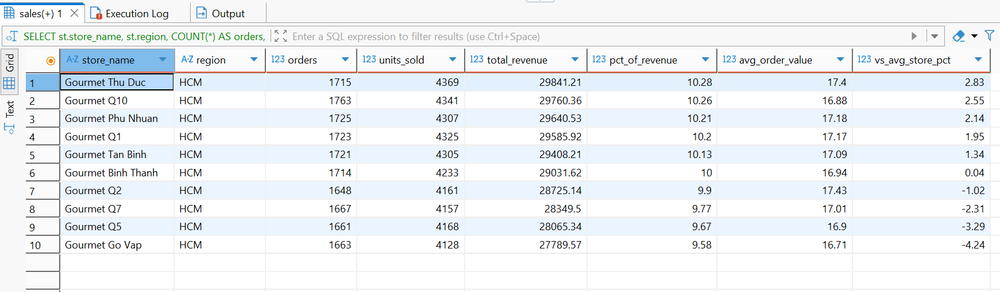

**Insight**: Revenue is spread very evenly across the 10 stores. Each earns between 9.58% and 10.28% of the total, and every store is within −4.24% to +2.83% of the average. The best store, *Gourmet Thu Duc* (29,841), earns only 7.4% more than the weakest, *Gourmet Go Vap* (27,790). *Thu Duc* leads by being above average on both orders (1,715 vs 1,700 average) and order value (17.40 vs 17.07). The four lowest stores (*Q2, Q7, Q5, Go Vap*) all have fewer than 1,670 orders, versus 1,714 or more for the top six, while order value is similar across stores. The gap between the groups is therefore mostly traffic, not basket size.

**Recommendation**: No store needs a turnaround. Focus on small, targeted actions instead of chain-wide changes. For the four lower-traffic stores, run local traffic-building promotions. *Q2* already has the highest order value, so it needs customers only. *Q10* gets plenty of orders, so test combos and add-ons there to lift its order value. *Go Vap* is below average on both and is the clearest candidate for a pilot. These differences are small, so treat them as signals to monitor and test, not as proof of a problem.

#### 2.2 Sales Trends

#### 2.2.1 Monthly revenue

```sql
SELECT MONTH(order_time) AS mth, 
		COUNT(DISTINCT CAST(s.order_time AS date)) AS days_with_sales,
		COUNT(*) AS orders,
		ROUND(SUM(quantity*price),2) AS total_rev,
		ROUND(SUM(quantity*price)/COUNT(DISTINCT CAST(s.order_time AS date)),2) AS rev_per_day
FROM sales s
JOIN menu m
ON s.menu_id = m.menu_id 
GROUP BY MONTH(order_time)
ORDER BY mth;
```

Result:

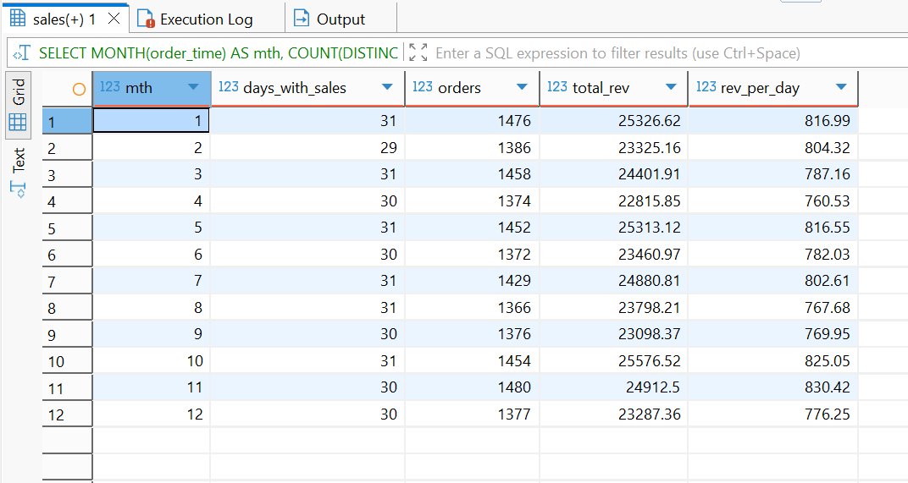

**Insight**: The data covers one full year 2024 of daily sales, with total revenue of 290,197 (an average month of 24,183, or 795 per day). Revenue is stable: monthly totals range only from 22,816 (April) to 25,577 (October), a gap of 12.1%, and every month is within about ±6% of the average. After adjusting for month length, revenue per day ranges from 760.53 (April) to 830.42 (November). April is the weakest month on both measures and rebounds 10.9% in May. The second half of the year is only 0.6% above the first, so there is no clear growth trend or seasonal pattern.

**Recommendation**: The swings are too small to justify broad discounting. April is slightly weaker on both orders per day (45.8 vs 46.6 average) and order value (16.61 vs 17.07), so test a small add-on or combo offer in slow periods and measure the result against that month’s revenue per day. With only one year of data, treat any pattern as something to monitor, not as confirmed seasonality.

#### 2.2.2 Month over Month grow

```sql
WITH monthly_revenue AS(
	SELECT MONTH(order_time) AS mth, ROUND(SUM(quantity*price),2) AS total_rev
	FROM sales s
	JOIN menu m
	ON s.menu_id = m.menu_id 
	GROUP BY MONTH(order_time)
)
SELECT mth, total_rev,
		ROUND(100.0*(total_rev-LAG(total_rev) OVER (ORDER BY mth))/
		NULLIF(LAG(total_rev) OVER (ORDER BY mth),0),2) AS growth
FROM monthly_revenue;
```

Result:


**Insight:** Month-over-month revenue growth ranges from −7.90% (February) to +10.95% (May), alternating between rises and falls with no sustained direction. The two largest increases (May +10.95%, October +10.73%) each follow a dip (April, September), so the changes are rebounds and not growth. 

**So what:** Don’t react to a single month’s drop. Track revenue per day alongside the monthly total, and treat a decline as a concern only if it lasts two or more months in a row after adjusting for month length. Based on these numbers, the larger lever for growth is more order volume and higher order value, covered in the weekday and peak-hour sections, and not seasonal promotion.

#### 2.2.3 Revenue of day by week

```sql
SELECT DATENAME(weekday,order_time) AS weekname, 
		COUNT(DISTINCT CAST(order_time AS date)) AS day_in_data,
		ROUND(SUM(quantity*price),2) AS total_rev,
		ROUND(1.0 * SUM(quantity*price) / COUNT(DISTINCT CAST(order_time AS date)),2) AS rev_per_day,
		ROUND(1.0 * SUM(quantity*price) / COUNT(*),2) AS AOV
FROM sales s
JOIN menu m
ON s.menu_id  = m.menu_id 
GROUP BY DATENAME(weekday, order_time)
ORDER BY total_rev DESC;
```

Result:

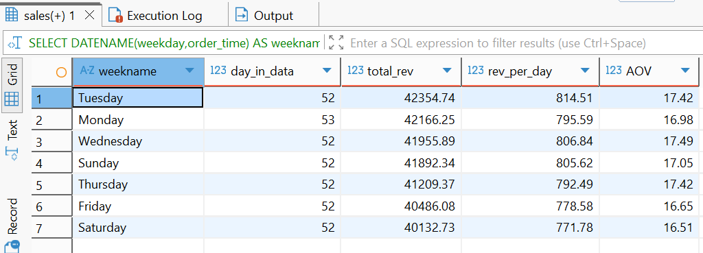

**Insight**: Revenue is steady across the week. Revenue per day ranges only from 771.78 (Saturday) to 814.51 (Tuesday), a gap of 5.54%. Weekends average 788.70 per day versus 797.60 on weekdays, just 1.1% lower, and Sunday (805.62) is above the overall daily average of 795.06. Monday ranks 2nd by total revenue only because it appears 53 times in the data, and falls to 4th per day. Saturday is weakest because of order value, not traffic: it has about average orders (46.75 per day) but the lowest value per order (16.51, vs 17.49 on Wednesday).

**Recommendation**: A weekend-wide promotion isn’t supported by the data. Target the real gap instead: raise order value on Friday and Saturday (16.65 and 16.51) with combos and add-ons, and measure the change in order value before and after. Keep the weekday approach unchanged. Since the data has no promotion information, avoid any claim about what is or isn’t working.

#### 2.2.4 Weekday vs Weekend

```sql
SELECT 
	CASE 
		WHEN DATENAME(weekday, order_time) IN ('Saturday', 'Sunday') THEN 'weekend'
		ELSE 'weekday'
	END AS type_of_date,
	COUNT(DISTINCT CAST(order_time AS date)) AS day_in_data,
		COUNT(*) AS total_ordered,
		ROUND(SUM(quantity*price),2) AS total_rev,
		ROUND(1.0 * SUM(quantity*price) / COUNT(DISTINCT CAST(order_time AS date)),2) AS rev_per_day,
		ROUND(1.0 * SUM(quantity*price) / COUNT(*),2) AS AOV
FROM sales s
JOIN menu m
ON s.menu_id  = m.menu_id 
GROUP BY CASE 
		WHEN DATENAME(weekday, order_time) IN ('Saturday', 'Sunday') THEN 'weekend'
		ELSE 'weekday'END;
```

Result

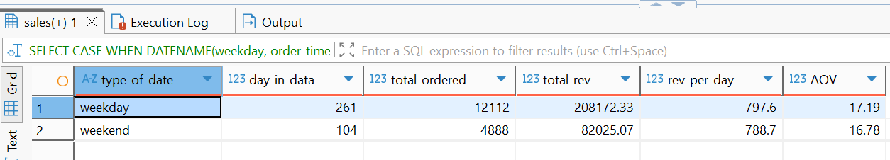

**Insight**: Weekdays and weekends perform almost identically once the number of days is taken into account. Weekdays earn 208,172 in total versus 82,025 on weekends, but that is because they cover 261 days vs 104. Per day, weekends earn 788.70 versus 797.60 on weekdays, only 1.1% lower. Weekends bring slightly more orders per day (47.00 vs 46.41) but a lower order value (16.78 vs 17.19, −2.4%). Within the weekend, Sunday (805.62 per day) is above average and Saturday (771.78) is the weakest day of the week.

**Recommend**: A broad weekend promotion to bring in more customers isn’t supported by the data, since weekend traffic is already as high as weekdays. The better target is order value, especially on Saturday: add combos and add-ons (for example a Drink or Snack with a Main) and compare Saturday’s order value before and after against its current 16.51. 

#### 2.2.5 Peak Hour

```sql
SELECT DATEPART(hour,order_time) AS hr, 
		COUNT(*) AS num_ordered,
		CAST(100.0 * COUNT(*) / SUM(COUNT(*)) OVER () AS decimal(5,2)) AS pct_per_order,
		ROUND(SUM(quantity*price),2) AS total_rev,
		CAST(100.0 * SUM(quantity*price)/ SUM(SUM(quantity*price)) OVER () AS decimal (5,2)) AS pct_per_rev,
		ROUND(1.0*SUM(quantity*price)/COUNT(*),2) AS avg_per_order
FROM sales s
JOIN menu m ON s.menu_id = m.menu_id 
GROUP BY DATEPART(hour,order_time)
ORDER BY hr;
```

Result

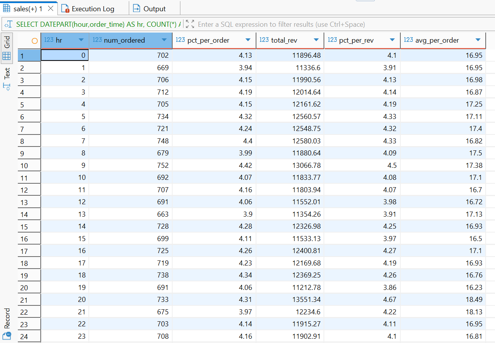

**Insight**: Orders are spread almost evenly across all 24 hours, so there are no clear peak hours. Each hour receives 3.90% to 4.42% of orders (an even split is 4.17%). The busiest hour, 9 AM (752 orders), is only 6.2% above the average hour, and the quietest, 1 PM (663), is 6.4% below. Each of the four 6-hour blocks earns between 24.6% and 25.4% of revenue. Two hours stand out slightly: 9 AM and 7 AM lead on orders (752 and 748), while 8 PM leads on revenue (13,551, 12.1% above the average hour) thanks to the highest order value (18.49 vs 17.07 average). 7 PM has the lowest order value (16.23).

**Recommendation**: The one clear opportunity is order value: replicate what happens at 8 to 9 PM (order value 18.49 and 18.13) in the weakest hours, 7 PM (16.23) and 3 PM (16.50), for example with a combo offer, and measure the change in order value. Because orders occur around the clock at the same rate, the timestamps may be simulated, so avoid meal-time conclusions.

## Final Conclusion

| Section | Key insight | Recommendation |
| --- | --- | --- |
| **2.1.1 Overall** | 290,197 revenue from 17,000 orders, 17.07 per order, about 2.5 items per order | Raise basket size with combos and add-ons |
| **2.1.2 Top 5 by units** | Matcha Latte leads (2,216 units, 5.21%). The top 5 make up about 25% of units, the same as an even split | Pilot bundles of best sellers; the data can’t show what is bought together |
| **2.1.3 Top 3 by revenue** | Tempura Set, Pork Dumplings and Avocado Toast earn 24.8% of revenue. Only Tempura Set is also a top-5 seller by units | Promote the high-revenue items; pair high-volume, low-price items with them |
| **2.1.4 Category** | Main 50.9%, Snack 31.13%, Drink 17.97%. Main has half the products and half the units, so its lead comes from menu size | Keep Main as the anchor, bundle Snack with Main, and grow Drink |
| **2.1.5 Best per category** | Matcha holds 35.82% of Drink. Snack is a close race (27% vs 25.33%). Tempura Set earns 1.7× an even share in Main | Protect Matcha supply and promote other Drinks; bundle both Snack leaders; test mid-ranked Main items |
| **2.1.7 Stores** | Stores are within −4.24% to +2.83% of average. Thu Duc is best (29,841) and Go Vap is lowest (27,790), a gap of 7.4%. The gap comes from traffic, not basket size | No turnaround needed. Run local promotions in the four low-traffic stores, test add-ons at Q10, pilot at Go Vap |
| **2.2.1 Monthly** | Months range from 22,816 (April) to 25,577 (October), within about ±6% of average; no seasonality | Don’t discount broadly. Track revenue per day and test an offer in April |
| **2.2.2 MoM growth** | Changes range from −7.90% to +10.95%, a zigzag with no trend | Act only on a decline lasting 2 or more months after adjusting for month length |
| **2.2.3 Day of week** | Revenue per day ranges from 771.78 (Saturday) to 814.51 (Tuesday), a 5.54% gap. Saturday has the lowest order value (16.51) | Raise order value on Friday and Saturday with combos |
| **2.2.4 Weekday vs weekend** | 797.60 vs 788.70 per day (−1.1%). The weekend has more orders per day but a lower order value (16.78 vs 17.19) | No weekend-wide promotion; target order value on Saturday |
| **2.2.5 Hours** | No peak hours (3.90% to 4.42% per hour). 8 PM has the highest revenue (13,551) and order value (18.49). 7 PM is the lowest (16.23) | Copy the 8 to 9 PM order value in weak hours such as 7 PM and 3 PM. The data may be simulated, so avoid meal-time claims |